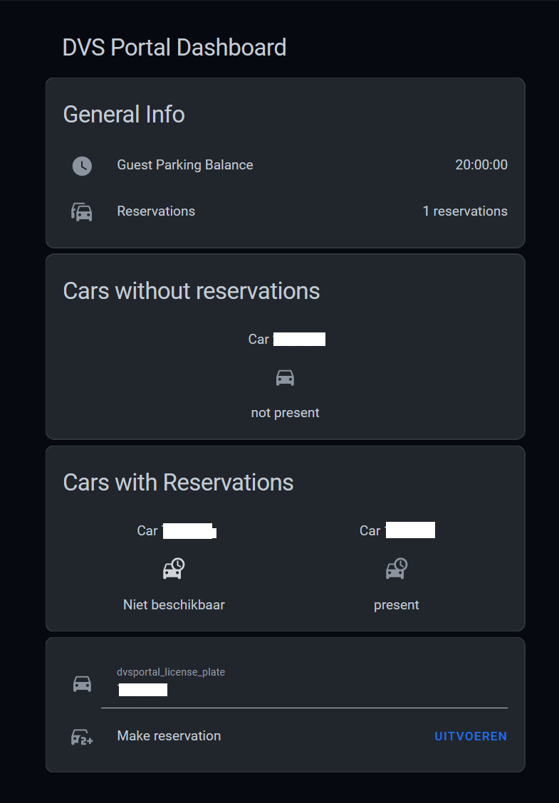

# DVS Portal Integration for Home Assistant

This integration is designed for the parking system used by some Dutch municipalities. It provides various sensors and functionalities to interact with the parking system directly from your Home Assistant instance.

If your parking system has "DVSPortal" in the url, you can use this integration.
[For examples, click here](https://www.google.com/search?q=inurl%3Advsportal)

[Read here how](DASHBOARD.md)

---

## ⚠️ Breaking change

Recent versions of this integration include a **breaking change**.

- Car sensors no longer expose a custom `device_class`
- Car sensors are now ENUM sensors
- Identification and filtering should be done using the attribute:
  - `dvs_entity: car`

If you use **Auto-Entities**, templates, or custom dashboards, you may need to update your filters accordingly.
See `DASHBOARD.md` for the updated examples.

---

## Features

- **Balance Sensor**: Shows the remaining balance for guest parking.
- **Active Reservations Sensor**: Displays the number of active and future reservations.
- **Car Sensors**: Dynamic sensors for each known license plate, showing its current state.

---

## Installation

For now, you'll have to manually add this repository to HACS:

1. Open HACS in Home Assistant.
2. Go to Integrations.
3. Click on the three dots in the top right corner and choose "Custom Repositories".
4. Add the URL of this repository.
5. Choose "Integration" as the category.
6. Click "Add".

After that, you can install it like any other HACS integration.

---

## Sensors

### Balance Sensor

- **State**: Remaining balance in minutes.
- **Attributes**: Additional information about the balance.

### Active Reservations Sensor

- **State**: Total number of active and future reservations.
- **Attributes**: Lists of license plates for current and future reservations.

### Car Sensors

- **State**:
  - `not present`: No active reservation
  - `present`: Currently has an active reservation
  - `reserved`: Has a future reservation

- **Attributes**:
  - License plate details
  - Reservation metadata
  - `dvs_entity: car`

---

## Credits

This integration was built upon the DVS Portal API implementation by
[tcoenraad](https://github.com/tcoenraad).

Original API repository:
https://github.com/tcoenraad/python-dvsportal

---

## Author

This integration was created by
[chessspider](https://github.com/chessspider).

---

## Issues and Contributions

For issues, feature requests, and contributions, please use the GitHub Issue Tracker:

https://github.com/chessspider/dvsportal/issues
